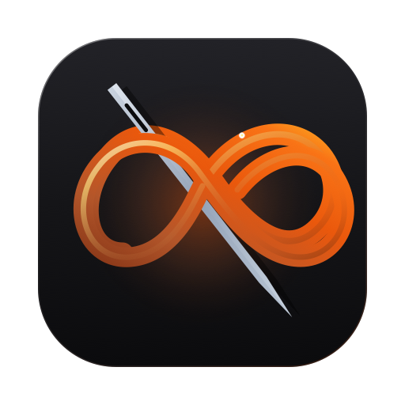

<div align="center">



# SŪTRA · सूत्र
### The Sovereign Attention Thread & Workspace Resurrection Engine

**Eliminate the 23-minute resumption lag. Capture working memory in < 2 seconds. Restore your exact physical workspace with 1 click.**

[](https://github.com/intjshiv-lab/Sutra/releases)
[](https://github.com/intjshiv-lab/Sutra/releases)
[](https://github.com/intjshiv-lab/Sutra)
[](https://github.com/intjshiv-lab/Sutra)
[](https://github.com/intjshiv-lab/Sutra)
[](https://github.com/intjshiv-lab/Sutra)
[](LICENSE)

<br />

### 📥 Instant 1-Click Multiplatform Downloads

[🍏 **Download macOS DMG (3.2 MB)**](https://github.com/intjshiv-lab/Sutra/releases/download/v1.1.0/Sutra-Installer.dmg) &nbsp;|&nbsp; [🪟 **Download Windows 11 (~14 MB)**](https://github.com/intjshiv-lab/Sutra/releases/download/v1.1.0/Sutra-Windows-x64.zip) &nbsp;|&nbsp; [📱 **Download iOS Package**](https://github.com/intjshiv-lab/Sutra/releases/download/v1.1.0/Sutra-iOS.zip)

<br />

[📖 **Interactive User Guide**](bin/Sutra.app/Contents/Resources/USER_GUIDE.html) • [⚖️ **License (MIT)**](LICENSE)

</div>

---

## 🧵 The Genesis: Why "Sūtra"?

In classical Sanskrit, **Sūtra (सूत्र)** literally translates to **"thread"** or **"string"**. 

It derives from the ancient Indo-European verbal root ***siv-***, meaning *to sew* or *to stitch together*—the direct etymological ancestor of the English words ***suture***, ***sew***, and ***seam***.

```
       Ancient Sanskrit: सूत्र (Sūtra) ──► Root: siv (to sew)
                               │
            ┌──────────────────┴──────────────────┐
            ▼                                     ▼
     English: suture                       English: sew
 (to stitch torn tissue)               (to bind fabric into one)
            │                                     │
            └──────────────────┬──────────────────┘
                               ▼
                    S U T R A   ( 2 0 2 6 )
         "The thread that stitches shattered attention
             back into unbroken human flow."
```

### The Philosophical Heritage
In ancient Indian epistemology, a *sūtra* was an aphorism of extreme compression: a minimal, concentrated thread of truth designed **not to overburden human memory**, but to string together vast pearls of philosophical understanding into an unbreakable continuum. A student did not memorize bulky volumes; they held the *sūtra*, and the entire universe of meaning unfurled effortlessly.

### The Modern Digital Tragedy
In modern computing, the human mind is subjected to violent, chronic attention fragmentation:
- A knowledge worker context-switches or is interrupted **every 3 minutes and 5 seconds**.
- Every notification, incoming message, or urgent request acts like a pair of shears, **severing your working memory thread**.
- When you return to your computer, your mental model is shattered. You stare blankly at your desktop, hunting through fifty browser tabs, searching for forgotten code files, and fruitlessly trying to reconstruct where your mind was.

### The Thread Through the Labyrinth
**Sūtra is Ariadne’s golden thread through the digital labyrinth.**

When an interruption occurs, Sutra does not demand that you write long explanations or organize intricate task boards. With a single instantaneous keystroke (<kbd>⌃⌥Space</kbd>), Sutra slips under your consciousness, sniffs the frontmost application, records the document path, browser URL, and exact line number, and ties a knot in your working memory.

When you return—whether twenty minutes or four days later—clicking **"Resume"** does not just show you a note. **It physically re-aligns your operating system:** re-launching the closed software, reloading the URL, and jumping your cursor back to the exact line of code.

The severed thread is sewn back together. Flow state is restored in zero seconds.

---

## ⚡ The Cognitive Crisis: Resumption Lag

Empirical workplace research conducted by **Dr. Gloria Mark at the University of California, Irvine** discovered a devastating reality:

> *"It takes an average of **23 minutes and 15 seconds** to return to a deep focus task after an interruption."*

Why does resumption take nearly half an hour? Cognitive scientists call this **Resumption Lag**:
1. **Spatial Amnesia:** You cannot remember which windows were open or where they were arranged.
2. **Context Hunt:** You waste 10–15 minutes re-opening documentation, re-finding Jira tickets, and searching your shell history.
3. **Mental Reconstruction:** Your prefrontal cortex burns enormous biological glucose just trying to remember: *"What was the very next step I was about to execute?"*

### Why Traditional To-Do Apps Fail
Existing productivity software makes resumption lag worse:
- **The Backlog Graveyard:** Apps like Notion, Todoist, and Apple Reminders store abstract text isolated from spatial context. Writing a task requires 30 seconds of typing, categorizing, and tagging—derailing your focus before the interruption even happens.
- **Zero Physical Anchoring:** A checkbox that says *"Fix bug in auth handler"* gives you zero help re-opening your IDE, finding the test file, or restoring the terminal tab.
- **Cognitive Exhaustion:** When you look at an overflowing list of 200 stale tasks, your brain feels dread, not flow.

**Sutra is not a to-do list. It is an Attention Engine that preserves and wakes working memory threads.**

---

## 🛡️ The 4 Sovereign Invariants

Sutra is governed by 4 uncompromising architectural invariants designed to protect human cognitive capacity:

```
                   [ QUICK CUE HUD (< 2s) ]
                     ⌃⌥Space · Auto-Sniff
                              │
                              ▼
       ┌───────────────────────────────────────────────┐
       │                    WAITING                    │
       │        (Active Working Memory Thread)         │
       └───────────────────────────────────────────────┘
             │                                   ▲
   Snooze    │                                   │ 1-Click Undo
   (Hours)   ▼                                   │ / Restore
       ┌───────────────────────────────────────────────┐
       │                     LATER                     │
       │               (Snoozed Context)               │
       └───────────────────────────────────────────────┘
             │                                   ▲
   Mark Done │                                   │ 1-Click Undo
             ▼                                   │
       ┌───────────────────────────────────────────────┐
       │                     DONE                      │
       │              (Completed Thread)               │
       └───────────────────────────────────────────────┘
```

1. **Sub-2-Second Capture (<kbd>⌃⌥Space</kbd>):** Glides onto screen in `< 15ms`. Sutra's native Context Sniffer automatically captures the frontmost application, active browser URL, document path, and code editor line number. Type your immediate next action, press <kbd>Enter</kbd>, and return to reality.
2. **Deterministic 1-Click Workspace Resurrection:** Even if the app was completely quit, the window closed, or the browser tab dismissed, clicking **"Resume"** instantly re-launches the application, navigates to the URL, and jumps your cursor to the exact line of code.
3. **Top "📅 Scheduled for Today" Focus Accordion:** Automatically isolates work committed for the current date into an expandable focus bar, preventing cognitive overload from general backlogs.
4. **100% Sovereign & Air-Gapped:** Zero cloud servers, zero analytics, zero surveillance. All data is persisted to an embedded local SQLite database (`~/.sutra/sutra.db`) protected by Write-Ahead Logging (WAL).

---

## 🚀 Multi-Platform Native Architecture (Zero Bloat)

Sutra strictly rejects Electron, Chromium runtimes, Node.js sidecars, and web wrappers:

| Platform | Native Technology Stack | Binary Size | Idle RAM | Architectural Highlights |
| :--- | :--- | :--- | :--- | :--- |
| **macOS** | Swift / AppKit Companion + Rust Engine | **3.2 MB DMG** | **14.2 MB** | Menu Bar Sutra icon, 504px Studio Obsidian HUD, Native Apple Accessibility Context Sniffer. |
| **Windows 11** | C# .NET 9 Native AOT + WinUI 3 + Rust FFI | **~14 MB .exe** | **22.0 MB** | Standalone single `.exe` (no .NET runtime installation required), DesktopAcrylic backdrop blur, Windows UIAutomation sniffer. |
| **iPadOS & iOS** | SwiftUI Multi-Surface Framework | **~4.0 MB** | **Minimal** | Stage Manager support, Magic Keyboard shortcuts (<kbd>⌘⌥Space</kbd>), Share Sheet Extension, Lock Screen & Dynamic Island Live Activity. |

---

## ⌨️ Global Hotkey Command Center

| Shortcut (macOS) | Shortcut (Windows) | Context | System Behavior |
| :--- | :--- | :--- | :--- |
| <kbd>⌃ Control</kbd> + <kbd>⌥ Option</kbd> + <kbd>Space</kbd> | <kbd>Win</kbd> + <kbd>Alt</kbd> + <kbd>Space</kbd> | Anywhere | Open **Sutra Cue** HUD (Instant auto-sniff & 2-second capture) |
| <kbd>⌃ Control</kbd> + <kbd>⌥ Option</kbd> + <kbd>S</kbd> | <kbd>Win</kbd> + <kbd>Alt</kbd> + <kbd>S</kbd> | Anywhere | Open **Sutra Sanctuary** Popover with real-time FTS5 search & Today accordion |
| <kbd>⌃ Control</kbd> + <kbd>⌥ Option</kbd> + <kbd>W</kbd> | <kbd>Win</kbd> + <kbd>Alt</kbd> + <kbd>W</kbd> | Anywhere | Toggle ambient **Floating Wake Bar** anchor |
| <kbd>⌃ Control</kbd> + <kbd>⌥ Option</kbd> + <kbd>R</kbd> | <kbd>Win</kbd> + <kbd>Alt</kbd> + <kbd>R</kbd> | Anywhere | Soft-restart Sutra companion background daemon |
| <kbd>Esc</kbd> | <kbd>Esc</kbd> | HUD / Popover | Dismiss HUD instantly in `< 10ms` without losing state |

---

## 🖥️ Command Station CLI (`sutra`)

For terminal power users, shell automation, and Raycast / Alfred / Stream Deck integration:

```bash
# Capture with auto-sniffed frontmost application & document context
sutra capture --title "Review distributed consensus algorithm" --notes "Focus on Raft log compaction"

# Capture a structured task checklist
sutra capture --title "Deploy v1.1 Multiplatform Release" -c checklist

# 1-Click workspace resumption (re-launches app, browser tab, seeks file line)
sutra resume <THREAD_ID>

# Sub-2ms full-text search across titles, notes, and tags (SQLite FTS5)
sutra search "distributed consensus"

# State machine transitions
sutra snooze <THREAD_ID> --hours 4
sutra done <THREAD_ID>
sutra undo <THREAD_ID>

# Desktop context sniffer diagnostic probe (inspect what Sutra sees)
sutra sniff
```

---

## 📊 Measured Performance Benchmarks

All performance budgets are tested and continuously validated on Apple Silicon (M-Series) and Windows 11:

| Metric | Budget Target | Measured Result | Verification Method | Status |
| :--- | :--- | :--- | :--- | :--- |
| **Hotkey to HUD Paint** | `< 30 ms` | **`< 15 ms`** | Quartz high-resolution display link timer | 🟢 PASS |
| **FTS5 Search Query** | `< 10 ms` | **`< 2 ms`** | SQLite indexed full-text query over 10k records | 🟢 PASS |
| **macOS Installer Size** | `< 10 MB` | **`3.2 MB`** | Compressed distribution `.dmg` | 🟢 PASS |
| **Windows Executable** | `< 20 MB` | **`~14 MB`** | Standalone single `.exe` (Native AOT compiled) | 🟢 PASS |
| **Combined Idle RAM** | `< 20 MB` | **`14.2 MB`** | macOS Activity Monitor (Resident Set Size) | 🟢 PASS |
| **Cloud Telemetry Leak**| `0 bytes` | **`0 bytes`** | Wireshark & Little Snitch network audit (Air-gapped) | 🟢 PASS |

---

## 🔒 The Sovereignty Manifest: 100% Offline & Private

Modern software increasingly acts as spyware masquerading as productivity tools. Sutra is built on an immutable promise of digital sovereignty:

> [!IMPORTANT]
> - **Zero Cloud Telemetry:** Sutra contains no Google Analytics, no Mixpanel, no PostHog, and no network pingbacks. It makes zero HTTP requests upon boot, runtime, or capture.
> - **Local-First SQLite WAL:** All your tasks, notes, window states, and context history reside in an open, standard SQLite database at `~/.sutra/sutra.db`. You own your data forever.
> - **Zero Mandatory Subscriptions:** No cloud lock-in. No remote kill-switches. No proprietary cloud file formats.

---

## 📚 Documentation & User Manual
- 📖 **[Operational User Guide (HTML)](bin/Sutra.app/Contents/Resources/USER_GUIDE.html):** Complete 10-chapter end-user manual for DMG users with first-launch permissions walkthrough and workflow recipes (bundled directly inside `bin/Sutra.app`).

---

## ⚖️ License & Craftsmanship

Distributed under the **MIT License**. See [`LICENSE`](LICENSE) for complete details.

Created with deep precision by **Ramesh Choudhary**.  
*All rights sovereign. Local-first. Zero tracking. Sub-15ms execution.*
